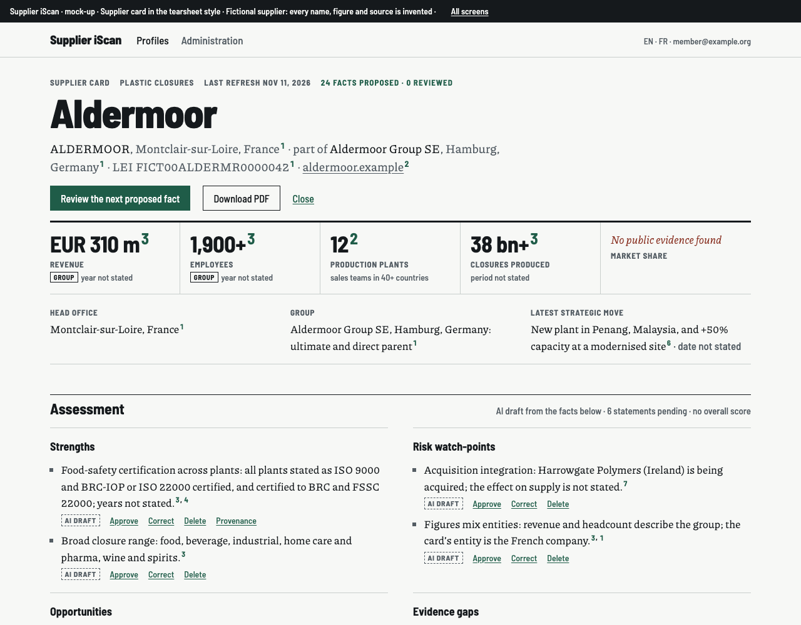
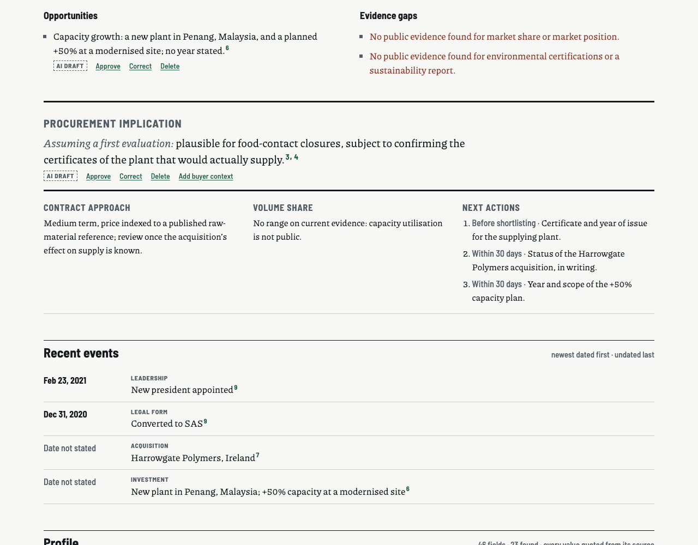
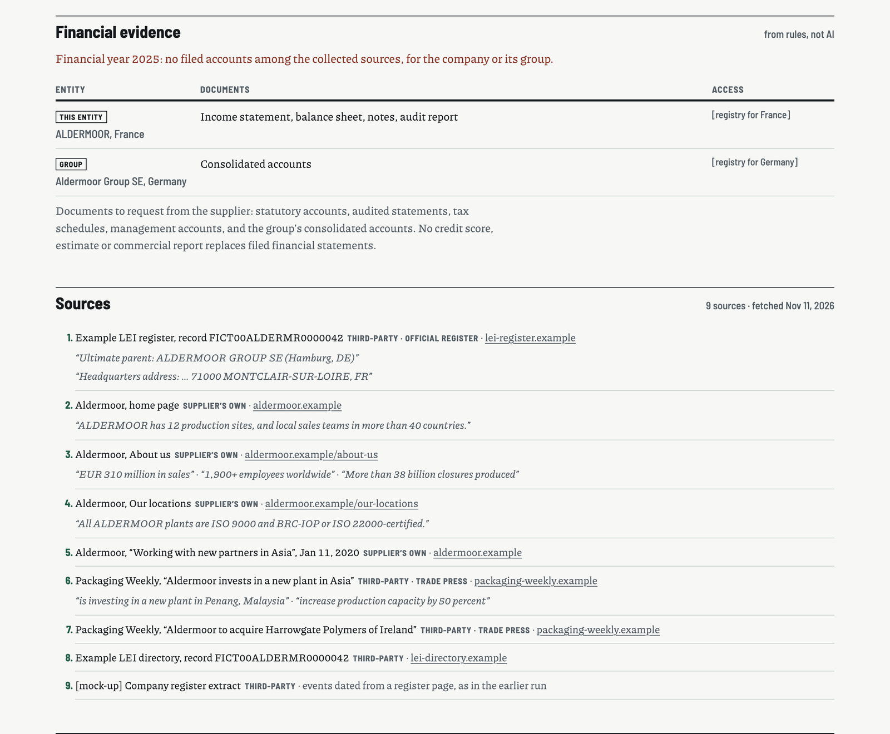
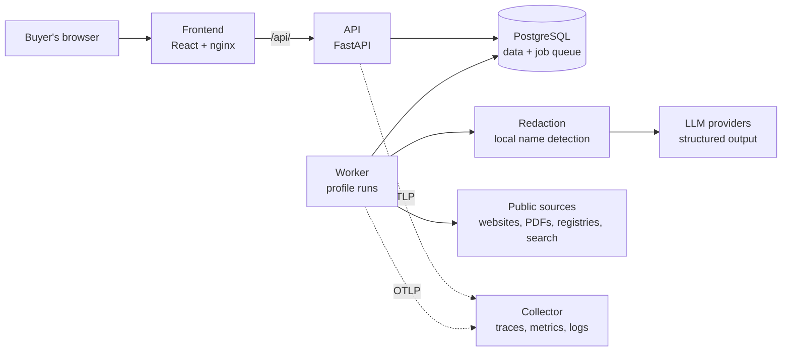

# Supplier iScan

**Evidence-based supplier profiles for procurement teams.** Every fact comes with its source, or the app says
there is none.

> Final project of the [AI Dev Tools Zoomcamp](https://github.com/DataTalksClub/ai-dev-tools-zoomcamp) (2026
> cohort). **Dev instance:** https://iscan-web-dev-939730526492.europe-west3.run.app (sign-in is by invitation; see
> [What it looks like](#what-it-looks-like) for the product).

## The problem

Buyers assemble a picture of a supplier by hand from websites, PDF reports and searches: hours per supplier, rarely
sourced, quickly stale. Generic AI chatbots are faster but invent facts and citations, so their output cannot go into
a supplier qualification file.

## What it does

1. **Confirms who the supplier is**, in a short chat: you name it, the AI proposes the company from public registries,
   you confirm or correct.
2. **Collects public evidence**: web pages, PDF reports, registries and web search, respecting each site's crawling
   choices.
3. **Fills a fixed profile.** Every value carries a verbatim quote, its source and date, checked in code against the
   source text. Missing information reads "No public evidence found", never "does not have".
4. **Drafts an assessment you can audit.** Each statement cites the facts it rests on. No black-box score.
5. **Leaves the decision to you.** You approve or correct every fact, compare suppliers and export a PDF.

The AI proposes; the buyer decides.

## What it looks like

The supplier card, as one page. **Aldermoor is fictional**: every name, figure, quote and source is invented (reserved
`.example` domains), so no real company is shown. Renders of the approved
[design](_docs/design/mockups/05-supplier-card-tearsheet.html), implemented by the app's card page (#163). Every value
has a note number; each note gives the source, its type (supplier's own or third-party) and the verbatim quote.







## Try it locally

You need Docker, GNU Make, [uv](https://docs.astral.sh/uv/) and Node.js (versions are pinned; `make install` checks
them).

```sh
make install   # dependencies, from the lockfiles
make run       # database, API and frontend with Docker Compose
make test      # backend and frontend tests
make lint
```

Open http://localhost:5173 in Chrome, Firefox or Edge (Safari refuses the `Secure` session cookie on plain
`http://localhost`) and sign in with the local-only account `admin@localhost` / `local-only-admin-change-me`. A full
profile run needs your own provider key. Everything else (configuration, costs, Codespaces, all commands) is in the
[guide](_docs/guide.md#running-it).

## Where each criterion is

| Criterion | Where to look |
| :--- | :--- |
| Problem description | [The problem](#the-problem), [What it does](#what-it-does) |
| Product specification | [`_docs/product/spec.md`](_docs/product/spec.md); tasks are the [GitHub issues](../../issues), each with checkable acceptance criteria ([template](_docs/process/task-template.md)) |
| Agent team specification | PM, SWE and QA role contracts in [`_docs/team/`](_docs/team/), wrappers in [`.claude/agents/`](.claude/agents/), workflow in [`process.md`](_docs/process/process.md); see [How it is built](#how-it-is-built) |
| Context management | [`AGENTS.md`](AGENTS.md) (short) points to the modular documents: spec, process, role contracts, API contract, [permissions](agent-pack/PERMISSIONS.md) |
| Application | FastAPI, React, PostgreSQL and a worker: [Architecture](#architecture) |
| Testing | Unit and integration tests (backend against real PostgreSQL), API contract test, frontend tests: `make test`; [details](_docs/guide.md#testing) |
| Containerization | [`docker-compose.yml`](docker-compose.yml): database, API, worker, frontend |
| Deployment | Google Cloud Run (EU) and Neon PostgreSQL (EU); [details](_docs/guide.md#deployment) |
| CI/CD | [`ci.yml`](.github/workflows/ci.yml) (lint, tests), [`images.yml`](.github/workflows/images.yml), [`deploy-dev.yml`](.github/workflows/deploy-dev.yml) (automatic on green `main`), [`promote-prod.yml`](.github/workflows/promote-prod.yml) (manual, required reviewer) |
| Observability | OpenTelemetry metrics, traces and logs with one trace ID, in Google Cloud Trace and Monitoring; [details](_docs/guide.md#observability) |
| Alerting, on-call agent | Built and merged ([#53](../../issues/53), PR #168): an alert on the profile-run failure rate, as code; an on-call workflow in which an agent diagnoses it, opens an issue and, when it can, a fix pull request (it never merges); [runbook](_docs/operations/oncall-runbook.md). The live drill on dev is described there; its evidence is not yet in this repository |

## Architecture



A profile run is a job in the PostgreSQL queue. The worker takes it through **identity**, **collection** (within a
request and domain budget), **extraction** (a value is kept only if its quote is found verbatim in the cited source)
and **assessment** (statements that cite facts). Text is redacted locally before it reaches any AI provider, and every
model answer is validated against a JSON schema.

Stack: React, Vite and TypeScript (pnpm); Python 3.13 and FastAPI (uv), contract first
([`openapi.yaml`](openapi.yaml)); PostgreSQL 16; GLiNER name redaction; Claude, Gemini, OpenAI, Mistral or Perplexity
chosen per role; WeasyPrint for the PDF; OpenTelemetry; Docker Compose locally, Google Cloud Run and Neon in the cloud.

## How it is built

Spec-driven and agent-assisted, with **Claude Code**. The specification comes first
([`_docs/product/spec.md`](_docs/product/spec.md)). A PM agent grooms each issue, a SWE agent implements it in its own
git worktree, and a QA agent checks every acceptance criterion and posts PASS or FAIL; a pull request merges on PASS
and green CI. I approve the specification, every design mock-up, every new dependency and every change of scope. The
[`agent-pack/`](agent-pack/README.md) gives the agents a skill for evidence wording, a read-only MCP server over
`openapi.yaml` and a hook that blocks secret files and unapproved installs.

## About the crawler

If you found a link to this page in your website's logs, it was left by the Supplier iScan crawler
(`SupplierIScan/1.0`). A buyer starts it for one named supplier at a time; it reads a few public pages about that
company to build a sourced profile. It follows `robots.txt` and text-and-data-mining reservations
(`tdm-reservation`, `tdmrep.json`), makes at most 200 requests across at most 10 websites per run, and never logs in,
fills in forms or gets around access controls.

To stop it visiting your site, add this to your `robots.txt`:

```
User-agent: SupplierIScan
Disallow: /
```

or open an issue in this repository naming your domain, and it will be added to the crawler's suppression list.
Someone running their own instance of Supplier iScan sets their own contact page (`CRAWLER_CONTACT_URL`).

## Known limitations

- **Entity versus group.** A profile describes the legal entity the buyer confirmed; the group's consolidated accounts
  are not yet gathered next to the local entity's.
- **Company registers do not cover every country.** The supplier is identified from GLEIF (global) and Wikidata;
  where neither has it, from a web search for its website, which the buyer confirms. National registers are not
  queried, so the legal entity may need checking by the buyer.
- **Public evidence only.** A missing fact reads "No public evidence found", which is not a statement about the
  supplier.
- **The hosted dev instance is a private demonstration.** Sign-in is by invitation, its demo list is empty, and its
  worker is off by default (zero cost) and reads the shipped example content, because Cloud Run worker pools cannot
  mount secret files yet. A complete run is shown locally with your own provider keys.
- PDF export needs the Pango libraries outside Docker; the card fonts cover Latin scripts.

## Roadmap

After the course (issues labelled [`after-submission`](../../issues?q=is%3Aissue+is%3Aopen+label%3Aafter-submission)):
the worker reading its content from Secret Manager, the comparison as a PDF, bias checks on the assessment, more
registries, the group's financial evidence, and a hosted offering for procurement teams.
